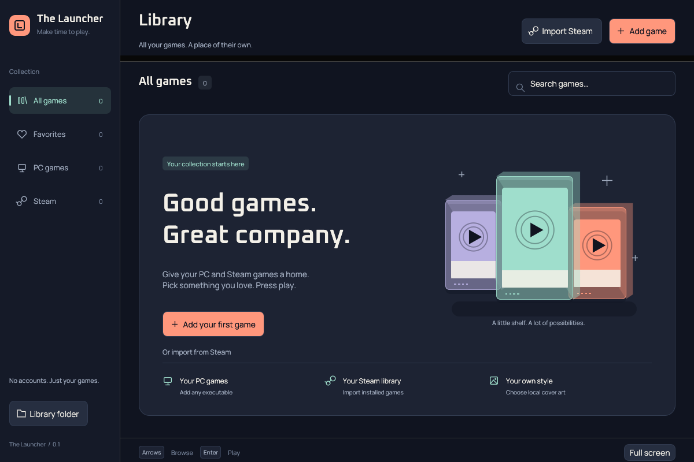

# The Launcher

A Windows game launcher with a console feel: a midnight library, cartridge-style covers, and one place to press Play. Inspired by Playnite’s unified library and [BoxShelf’s](https://github.com/sassiestrhihno/boxshelf-beta) tactile shelves. This is an independent implementation; no source or artwork is copied from either project.

**Status: early foundation, not a packaged release.** Application logic and UI are Rust. Bun provides convenient development commands; the built application does not require Bun, Node, a browser, or a webview.



## What works

- Add a local game, choose its executable, name it, and set arguments and a working directory.
- Launch games, edit launch options, favorite entries, search, and filter by source.
- Import installed Steam games from a selected Steam installation and its additional libraries. Existing Steam entries are preserved. Launch through Steam’s registered URI handler.
- Persist a local JSON library with atomic replacement and a single-instance lock.
- Choose local PNG/JPEG cover art for any game, with original generated art as a fallback.
- Browse with mouse or arrow keys, press Enter to play, and toggle full screen with F11. Tab navigates controls.

No demo games are added to the real library. The generated cartridge labels are original artwork, not downloaded box art. Select a game and use **Options → Choose cover art…** to add a local image. Controller input and a 3D shelf are future work.

## Develop on Windows

Install [Rust stable](https://rustup.rs/) **1.92 or newer** with the MSVC toolchain and Visual Studio Build Tools (Desktop development with C++, including a Windows SDK). Install [Bun](https://bun.sh/docs/installation). A GPU/driver supporting OpenGL 3.3 or later is needed.

```powershell
bun run dev
bun run check
bun run build
```

There are no JavaScript packages to install. `cargo run` works directly too. First compilation downloads Rust dependencies and takes longer. Release output: `target/release/the-launcher.exe`. No installer, signing, or automatic update system exists yet.

Linux is a development host, not a supported release target. Install C/C++ build tools, pkg-config, and the X11/Wayland and OpenGL development packages for your distribution. A graphical session and a working native file-dialog backend are needed to exercise the UI. Linux development can launch native executables; Windows requires `.exe` files.

## Add and play

1. Select **Add game**, then **Browse…**, and choose a game’s `.exe`.
2. Give it a name. Arguments go one per line: `--profile` and `My Profile` are two lines. Do not wrap arguments containing spaces in quotes. Leave the working directory empty to use the executable’s folder.
3. Save, select the tile, and press **Play**. A launch request means the OS accepted the process/URI request, not that the game finished loading.
4. For Steam, select **Import Steam** and choose the Steam installation folder containing `steamapps`, usually `C:\Program Files (x86)\Steam`. The importer also reads `steamapps/libraryfolders.vdf` for other libraries. Steam must be installed and its `steam://` handler registered to launch an imported game. No Steam login or Web API key is used.

Import is additive. It does not remove uninstalled games or overwrite your existing names/favorites. Steam manifests can include tools or DLC; this first importer does not query Steam’s catalogue to distinguish them. Disconnecting a drive skips that additional library. A malformed manifest aborts the import with a path-specific error and leaves the library unchanged.

Removing an entry only removes it from this launcher, never from disk or Steam. Executables run with the launcher’s normal user permissions; add programs you trust.

## Data and recovery

On Windows, the library is `%LOCALAPPDATA%\TheLauncher\data\library.json`. Use **Open library folder** for the actual platform-specific location. The adjacent `library.lock` prevents two instances from overwriting each other; the OS releases it when the app exits, and the file may remain.

Back up `library.json` before manual edits. Close the app first. If JSON is damaged or its schema is newer than supported, startup stops and displays its path instead of resetting your collection. Restore your backup or repair the file. Atomic writes protect an existing library if saving fails; they are not a versioned backup system or a guarantee against every power-loss scenario.

## Project notes

- [Native visual system and cover art](docs/design.md)
- [Architecture and decisions](docs/architecture.md)
- [Development and validation](docs/development.md)
- [Roadmap](docs/roadmap.md)
- [Data format](docs/library-format.md)

Keep behavioral changes and their docs in the same change. The first milestones favor reliable local launching before metadata services, accounts, plugins, or synchronization. The project’s distribution license has not been chosen yet; choose one before publishing releases.
