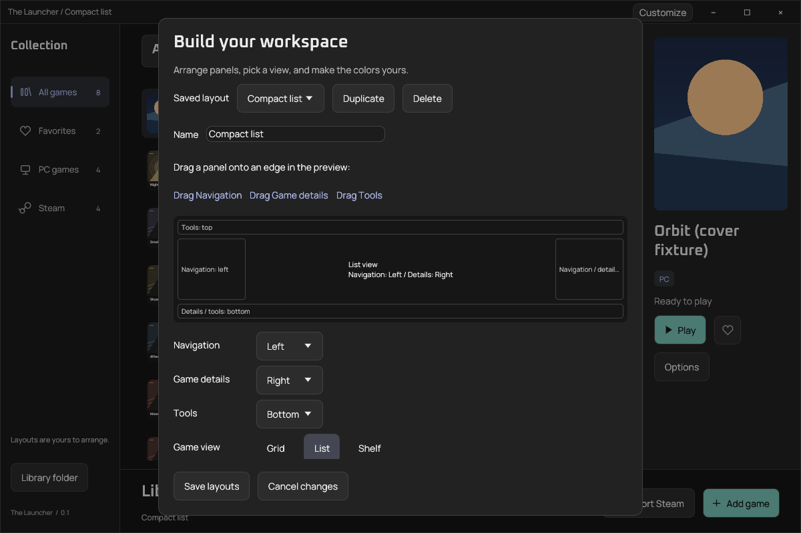
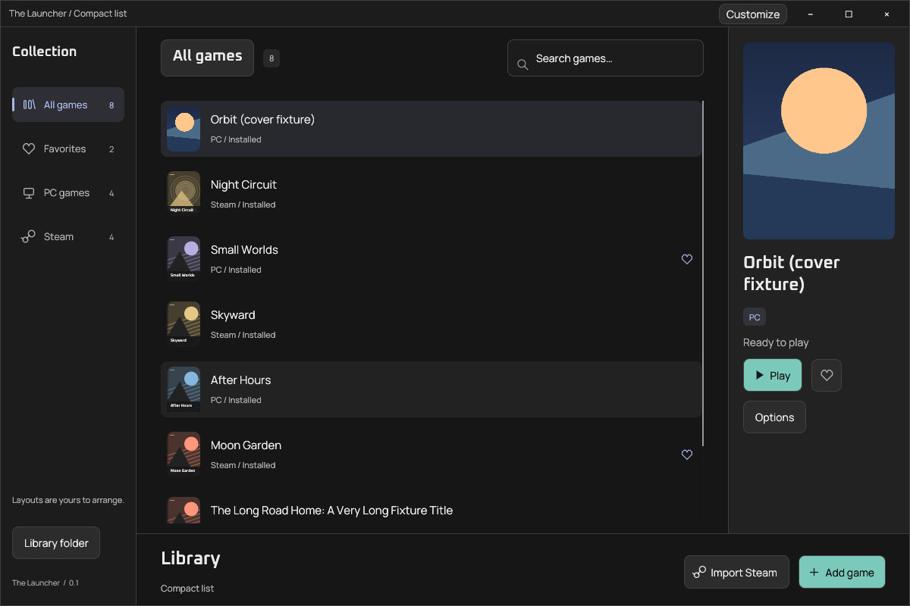
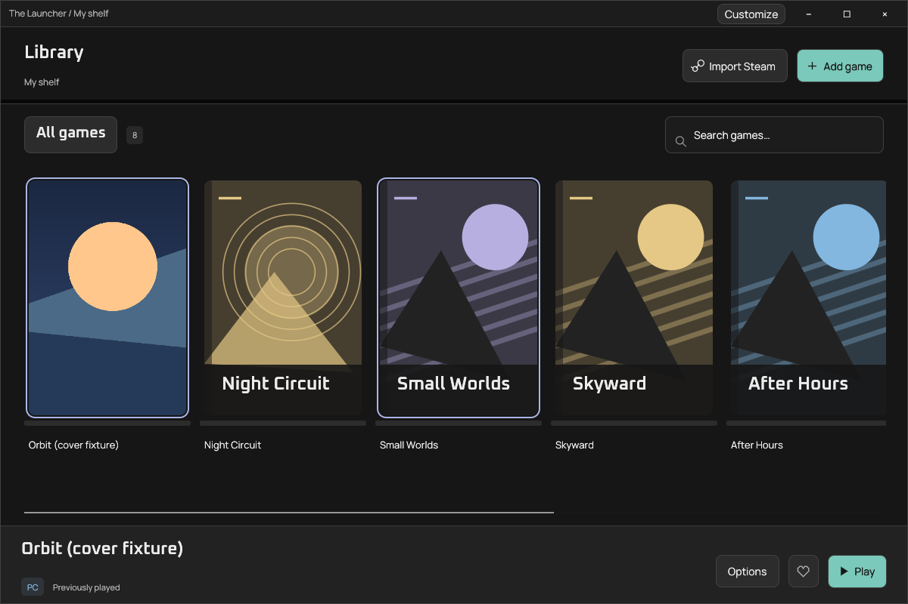

# Build your workspace

The launcher is a library/launch engine with a user-arranged presentation. The bundled appearance is a starting point. Users build their layout through **Customize**; they do not need to author Rust or a theme package.

## Visual editor

Select **Customize** in the launcher’s title bar. It remains available even when navigation and details are hidden. In full screen, use the shortcuts bar; if that is hidden too, Customize appears in the collection toolbar. F11 always exits full screen.

- Drag **Navigation**, **Game details**, or **Tools** onto a supported edge in the preview. The controls below it provide the same placements without dragging.
- Navigation can sit on the left, right, or be hidden. Details can sit below the collection, on the right, or be hidden. Tools can sit above or below it.
- Choose **Grid**, **List**, or **Shelf**. Grid wraps portrait covers; List shows compact rows; Shelf is a horizontally scrolling row of cases. These are working views of the same library, not separate collections.
- Adjust cover width and panel widths. Narrow windows cap side-panel widths to preserve space for the collection.
- Edit the canvas, navigation, panel, control, text, border, action, and selection colors. Changes preview immediately across the shell, title bar, controls, and dialogs. Artwork retains its own colors.
- Duplicate a layout, name it, and keep up to 32 named layouts. Switch them in the editor. **Save layouts** commits the workspace; **Cancel changes** restores the complete workspace from before the editor opened, including colors, selection, and any duplicates/deletions.

This first editor supports docking existing components into defined regions. It is not yet a freeform widget canvas, arbitrary nesting system, user-script engine, or font/asset-package editor. Those require a component contract before adding more editor controls. None is implied by a saved layout in this version.

## Persistence and recovery

`workspace.json` lives beside `library.json`, under the application’s local data folder. It contains a version, an active-layout index, and named layouts with presentation and skin settings. It never contains launch arguments, Steam API keys, or game entries. Library files retain their existing format.

Saving validates layout names, positions, and supported size ranges, then atomically replaces the file. The UI can show a temporary default if the saved workspace is damaged or from a newer version; it preserves the existing file until the user explicitly saves a new workspace. Close the launcher and back up both JSON files before manual edits.

## Window behavior

The launcher owns its frame, so Windows’ accent-colored standard title bar is not part of the skin. The frame provides minimize, maximize/restore, close, drag, double-click-to-maximize, and edge/corner resize controls. These send viewport commands to the native backend; they do not simulate window movement with a frame-by-frame position loop. Alt+F4 is still handled by the window backend.

Windows docking, Snap behavior, high DPI, keyboard focus, and system-menu behavior need real Windows validation. The custom maximize button does not implement Windows 11’s hover Snap-layout flyout. File pickers remain native system dialogs; they are intentionally outside the launcher skin. User-selected colors can reduce contrast; the bundled skin has contrast tests, arbitrary custom palettes do not get an accessibility guarantee.

## Developer boundaries

`src/workspace.rs` defines and validates the saved model. `src/ui/editor.rs` edits it. The regular renderer reads the active layout rather than owning the arrangement. `src/ui/theme.rs` applies the active skin to egui and custom painting. `src/ui/frame.rs` owns window chrome; `src/ui/views.rs` owns list/shelf rendering and right-hand details.

To add a configurable component, define its supported docking behavior and persistent model, implement its renderer, wire it into the editor, and add restart/layout-bound tests. Keep game and integration operations independent of panel positions.

## Native captures

These captures use an isolated synthetic fixture library and an alternative user skin. They are actual Rust application windows under a Linux virtual display. The editor and renderer share the same saved model. The list/shelf fixtures do not represent games installed on a real user's machine.

