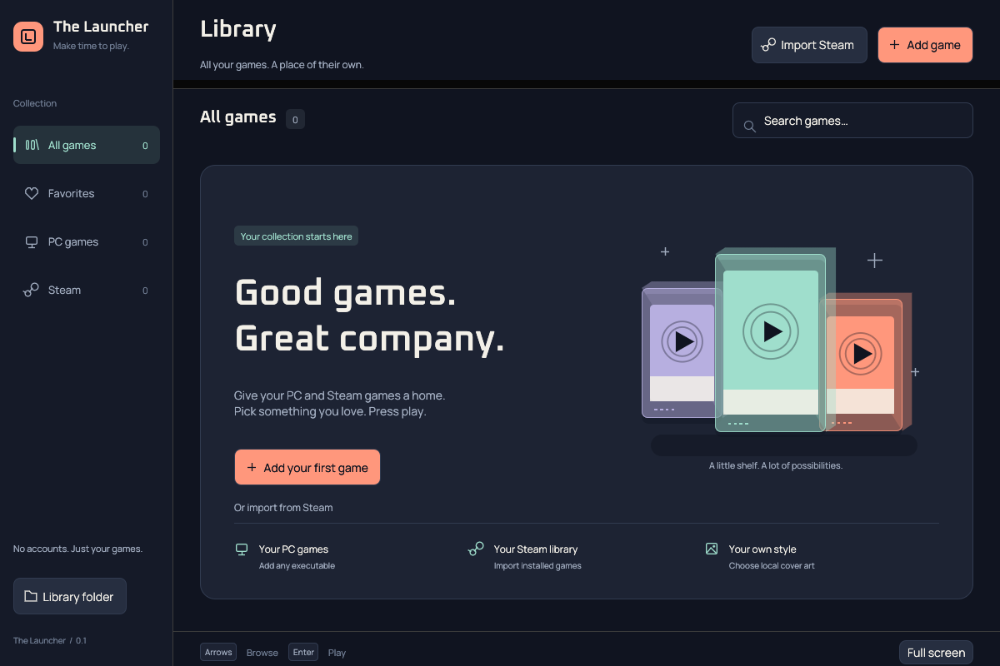
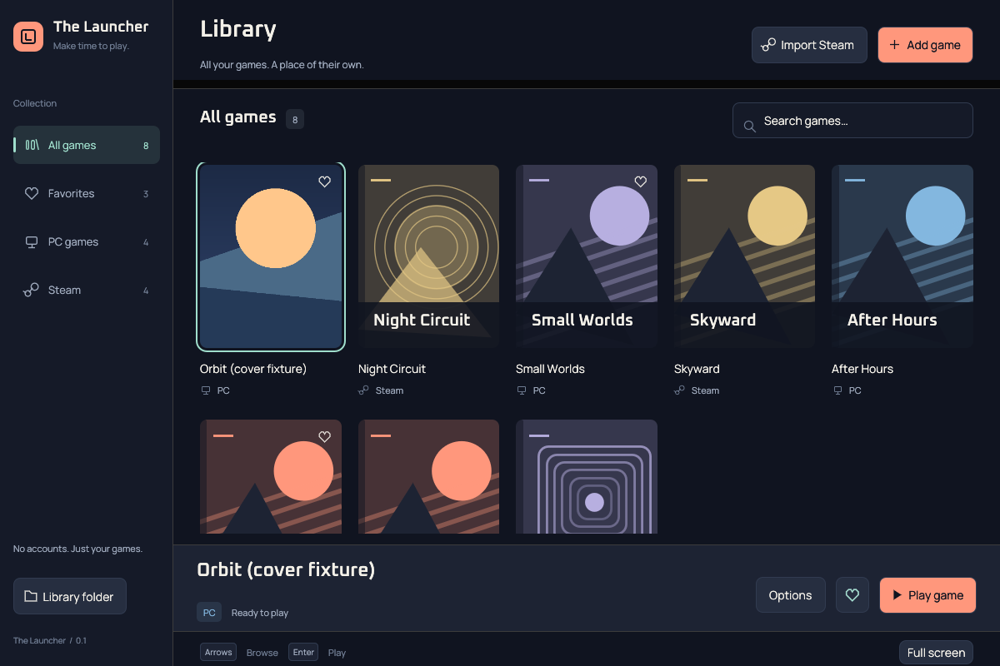
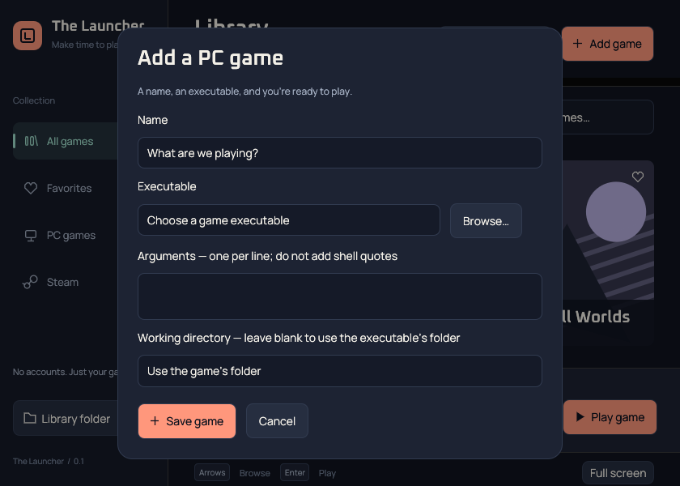

# Native visual system

The launcher takes its cues from console collection screens and physical game cases. The design stays in Rust/egui. It does not use HTML, CSS, a webview, remote fonts, or a 3D renderer.

## Palette and type

| Token | Color | Use |
| --- | --- | --- |
| `BG` | `#101420` | Main midnight canvas |
| `RAIL` | `#151a28` | Navigation and inputs |
| `SURFACE` | `#1d2333` | Welcome panel, selected-game dock, dialogs |
| `TEXT` | `#f3f0e8` | Warm ivory text |
| `CORAL` | `#ff977c` | Add and Play actions |
| `MINT` | `#9fdecc` | Active collection, keyboard focus, selection |
| `LILAC` | `#b7afe0` | Original fallback artwork |

Manrope Regular is the body face; Oxanium SemiBold gives headings a squared console character. Both are embedded under SIL OFL licenses; sources and regeneration instructions live in `assets/fonts/README.md`. The OS title bar remains native, so its accent color follows Windows preferences. A matching application icon replaces eframe’s default icon.

## Composition

A 208-point navigation rail holds the brand, source/favorite filters with real counts, and library-folder access. The main header owns Add and Steam import. The collection toolbar contains the current collection and search. A selected-game dock anchors the Play action below the responsive cover grid.

The empty collection shows an original, vector-drawn trio of cartridge cases and a direct invitation to add or import games. It creates no fictional entries. Shorter windows omit supporting tips, and the welcome panel and add dialog scroll when necessary. Filtered-empty views offer a way to clear the search and return to all games.

Tiles use original title-based artwork until a local cover is selected. The title’s hash picks its colors/composition, so removing or filtering another game does not change its appearance. Long titles are truncated visually; full titles remain in hover text and accessible labels. Focus and selected tiles use mint outlines. Icons are drawn with paths rather than relying on emoji or missing font symbols. These are desktop layouts, not a claim of complete controller or screen-reader support.

## Local cover art

Select a game, then **Options → Choose cover art…**. PNG and JPEG are supported. Covers center-crop to the tile’s portrait ratio without stretching. **Remove cover art** returns to generated artwork. Editing executable launch options preserves the chosen cover.

The optional `cover` JSON field stores a local file reference, not a copied image. Keep that file in place. Missing or invalid images fall back to generated artwork, with the error available in the tile’s tooltip. Select the image again or restart to refresh an externally edited file. The launcher does not download, collect, or license commercial game artwork for you.

Images are limited to 16 MiB and 4096 pixels per dimension, decoded with a 64 MiB allocation limit, and thumbnailed to at most 480×720 before GPU upload. Only visible tiles request images. A 64-entry cache bounds retained textures; reaching the limit clears old cache entries. Decoding is synchronous on first display; revisit background decoding if profiling large imports shows visible stalls.

## Interaction and validation

Mouse, Tab, arrows, Enter to play, and F11 remain available. Up/down navigation moves by grid row; arrow navigation scrolls the selected tile into view without animation. Search fields, modal dialogs, and popup menus retain their own keyboard behavior. Escape cancels the add/edit dialog.

Headless egui tests check that empty and populated layouts fit the supported minimum and larger window sizes. Native captures and manual interaction checks complement these tests. Verify Windows title-bar behavior, high DPI, cover file picking, and accessibility on Windows hardware before release.

## Captures

These are captures of the actual native application on a Linux virtual display, not web mockups. The populated screenshot uses an isolated synthetic fixture library and an original local image to exercise cover loading. These names and entries are not shipped to users.

