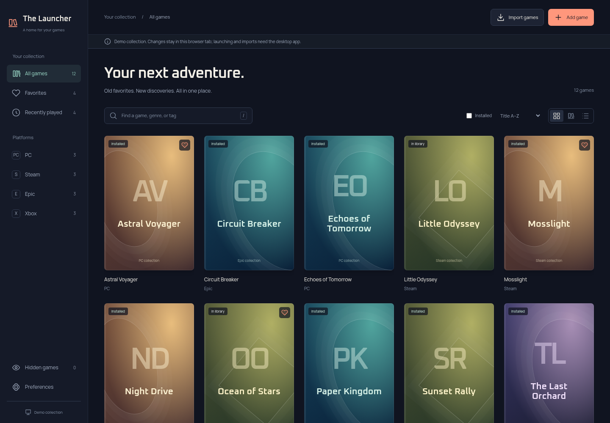
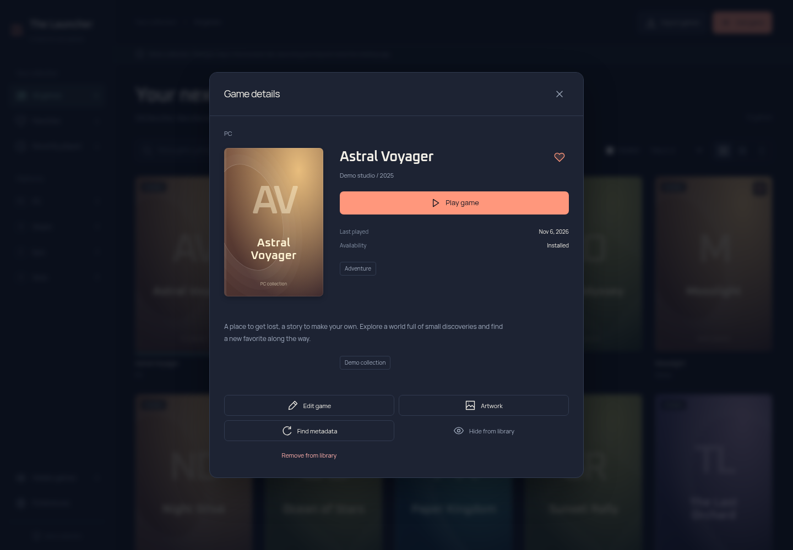

# Desktop rewrite report

The Rune interface has been replaced with Tauri 2, Svelte 5 and TypeScript. Rust retains discovery, metadata, safe launching and persistence. Existing schema-1 libraries keep their data directory and serialized model. No real user library was used for testing or screenshots.

## What changed

- Redesigned grid/list/shelf screens, search by title/genre/tag, source/favorite/recent/installed filters, clear empty states, and responsive details.
- Add/edit executable options, names, tags and series; favorites; hide/restore; confirmed removal. Store import and protocol dispatch remain native.
- Metadata matching, preservation-aware fills/replacement, a sequential bulk queue with stop controls, local/provider artwork previews and choices, backgrounds/logos and source attribution.
- Named layouts, skin colors, panel placement and view/size settings, with live draft preview and Cancel. Native window controls replace the custom Rune frame; explicit placement controls replace drag-to-dock editing.
- Validated backup/restore including workspace and provider preferences. Files stage before replacement and attempt rollback on IO failure. This is not a power-loss-proof multi-file transaction; game/artwork binaries are not included.
- Lazy native thumbnails, four in-flight cover requests, a 64-entry LRU, offscreen reference release, and initial batches of 80 cards.
- A browser-only demo uses synthetic entries and tab-scoped storage. It cannot access the native library. Docker hosting, synchronization, ROM/emulator profiles and physical-copy records remain roadmap work.

## Issues found and fixed

Overlapping native writes could otherwise save stale library snapshots; a shared asynchronous write gate now serializes writes without holding the in-memory mutex across IO. Editor saves apply only editor-owned fields, so concurrent metadata/favorite changes survive. Non-Steam matching aligns the request baseline before merge and rejects a late rematch. Known-uninstalled Steam dispatch no longer records a played date. Damaged or duplicate library data fails safely. Backups cannot overwrite live state files. Native startup failures show a recovery error dialog. Controller polling resumes after closing a preferences dialog. Late metadata/artwork results check the dialog instance before updating or closing it, so they cannot dismiss a newer editor.

## Verification

- `bun install --frozen-lockfile`: passed.
- `bun run check`: Svelte diagnostics (zero errors/warnings), 3 frontend unit tests, production Vite build, Rust formatting, Clippy with warnings denied, and **56 Rust tests** passed.
- `bun run test:ui`: **9 tests passed**. They cover browse/search/favorite/hide/restore, add/edit/remove, keyboard/dialog behavior, mobile bounds, launch errors, a 5,000-entry search, controller transitions, and mocked desktop IPC payloads/registered command names.
- The accessibility test scans the default library and details dialog with axe: zero serious/critical violations. This is not a complete accessibility certification or real screen-reader test.
- `cargo clippy --features desktop,custom-protocol --all-targets --target x86_64-pc-windows-gnu -- -D warnings`: passed against the real Tauri/rfd SDK, including production asset/context generation. This type-checks Windows code; it does not execute a Windows app or produce a validated installer.
- `actionlint .github/workflows/windows.yml`: passed. The pinned Windows MSVC/native-test/NSIS workflow is ready for its first hosted run; it was not pushed or run here.
- Screenshot capture and visual inspection: implemented screens, not mockups. Synthetic titles and original generated art are clearly labelled in the UI.

## Performance measurements

Measured 2026-11-09T11:22:21.405Z with headless Chromium 156.0.8078.79 on the shared Linux host, serving production assets from localhost. Hardware: Intel Core i3-6100T at 3.20 GHz, Debian 13 x86_64; container quota of four logical CPUs and approximately 8 GiB RAM. Three isolated browser contexts per library size. Values below are medians; raw samples preserve variation. No CPU throttling was applied. No pre-rewrite or Playnite baseline was recorded, so no relative speed/memory claim is made.

| Synthetic games | Library ready | Search | JS heap after search | Idle renderer task time |
| --- | --- | --- | --- | --- |
| 100 | 771 ms | 64 ms | 5.4 MiB | 0.16% |
| 1,000 | 919 ms | 129 ms | 11.8 MiB | 0.18% |
| 5,000 | 1137 ms | 181 ms | 26.5 MiB | 0.22% |

Ready includes navigation, fixture generation, rendering and bundled fonts. Search includes Playwright overhead. Heap is JavaScript heap only, excluding native/webview/GPU memory. Idle is CDP renderer TaskDuration divided by a five-second observation interval after a one-second settling period, not system-wide CPU. Timing varies with host load and cold caches; the 100-entry cold load can be slower than larger warm runs.

The production JavaScript asset is **96.1 KB raw / 35.2 KB gzip**. Bundled fonts total 126.6 KB raw. These are frontend asset sizes, not installer or total runtime sizes. Native Windows startup, RSS, GPU and controller-attached idle costs remain unmeasured.

[Interactive chart](performance/rewrite.html) · [Raw samples and asset sizes](performance/rewrite.json) · [Benchmark script](../scripts/performance.mjs)

## Screenshots

All captures are the actual Svelte interface in the explicit browser demo, with synthetic games and original generated artwork. They are not Windows-native captures.

[Case shelf](screenshots/rewrite/library-shelf.png) · [List](screenshots/rewrite/library-list.png) · [Preferences](screenshots/rewrite/preferences.png) · [Add game](screenshots/rewrite/add-game.png) · [Empty library](screenshots/rewrite/library-empty.png) · [Mobile layout](screenshots/rewrite/library-mobile.png)

## Remaining validation and release work

This Linux host lacks GTK/WebKit development libraries and sudo, so a native Linux window could not run. Windows code passed cross-checks, but **MSVC release/NSIS build execution, native IPC/window/file-dialog behavior, real store dispatch, real controllers, DPI/multiple monitors, screen readers and clean-machine installation remain unverified**. The Windows CI workflow and smoke checklist in [development](development.md) cover those next checks. No installer is claimed as tested or release-ready. A distribution license, signing and updater strategy remain release decisions.

The source changes are in the working tree. No commit, push, PR or release was made. See the [roadmap](roadmap.md) for retro ownership records, external emulator profiles, Docker/mobile catalogue and later remote-play integrations.
